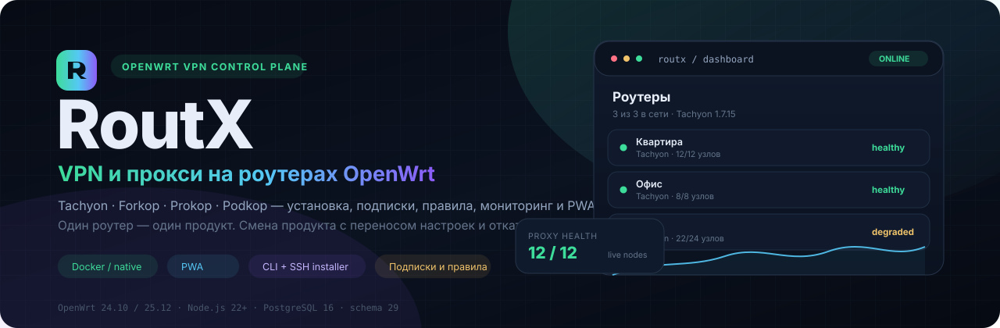
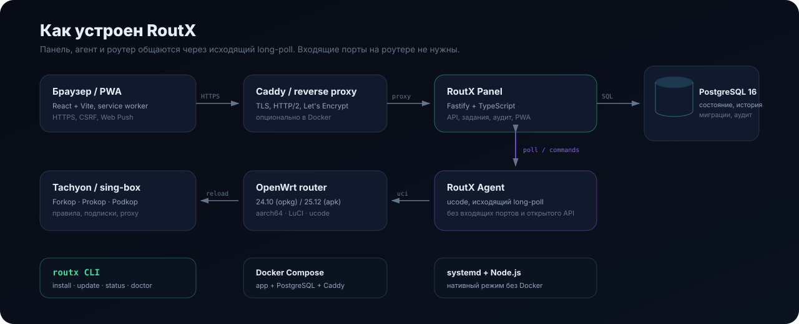

<p align="center">
  
</p>

<p align="center">
  
  
  
  
  
  
  
  
  
</p>

<h1 align="center">RoutX</h1>

<p align="center">
  <a href="https://seriec163.github.io/routx/"><b>Сайт и инструкция по установке</b></a> ·
  <a href="https://t.me/unc1escrooge">Telegram</a> ·
  <a href="https://github.com/seriec163/routx">GitHub</a>
</p>

<p align="center">
  Централизованная панель для VPN и прокси на роутерах OpenWrt: установка и переключение
  <b>Tachyon</b>, <b>Forkop</b>, <b>Prokop</b> и <b>Podkop</b>, подписки,
  правила маршрутизации, мониторинг и PWA.
</p>

<p align="center">
  <a href="#быстрый-старт">Быстрый старт</a> ·
  <a href="#возможности">Возможности</a> ·
  <a href="#архитектура">Архитектура</a> ·
  <a href="#cli">CLI</a> ·
  <a href="#документация">Документация</a>
</p>

> **Один роутер — один продукт.** RoutX ставит выбранный продукт, удаляет
> остальные и переносит секции, списки, домены и подписки. Перед изменениями
> создаётся снимок, при ошибке выполняется откат.
>
> **Область управления.** RoutX управляет VPN/прокси-продуктом на роутере,
> его правилами, списками, подписками и агентом. Прошивка, сеть, firewall и
> остальные настройки OpenWrt остаются вне панели.

---

## Возможности

| | |
|:--|:--|
| 🧭 **Единый центр управления** | Все VPN-подключения, продукты, версии и статусы роутеров в одной панели. |
| 🚀 **Установка одной командой** | Docker Compose или нативный Node.js + PostgreSQL. CLI `routx` сам готовит `.env`, администратора и базу. |
| 🔁 **Смена и переустановка продукта** | Выбор версии Tachyon, удаление старых пакетов, перенос настроек и автоматический откат. |
| 📦 **Каталог tachyon-lists** | 143 списка с описаниями, группами и счётчиками. Для Tachyon — нативно, для Forkop — rule-set, для Prokop — SRS, для Podkop — домены и подсети. |
| 🧩 **Правила без шаблонов** | Секции, домены, IP, community lists, подписки и прямые ссылки. |
| 🚀 **Развёртывание шаблонов** | Отметьте роутеры, проверьте diff и примените шаблон на всех сразу — со снимком и откатом. |
| 📊 **Мониторинг** | Задержка, живые узлы, direct/VPN IP, история, топ нестабильных соединений и потери связи за 24 часа. |
| 🔐 **Безопасность** | Токены агентов, CSRF, rate limit, аудит, мастер-ключ, read-only контейнер, passkey Face ID/Touch ID и одноразовые резервные коды. |
| 🛡 **Три уровня доступа** | Суперадминистратор, администратор своей ветки и пользователь. Суперадминистратор может безопасно войти под пользователем для поддержки. |
| 📱 **PWA** | Мобильный интерфейс, push-уведомления, QR-вход и привязка устройства: сессия продлевается сама и переживает перезапуск приложения. |
| 🛠 **CLI `routx`** | `install`, `update`, `rollback`, `status`, `logs`, `restart`, `doctor`, `uninstall`. |
| 🔄 **Обновление из панели** | Проверка GitHub, кнопка «Обновить» и автоматический откат предыдущего образа при ошибке. |

---

## Быстрый старт

Установка одной командой на Debian / Ubuntu. Скрипт скачает исходники с
GitHub, запустит нативную установку и откроет мастер:

```sh
curl -fsSL https://raw.githubusercontent.com/seriec163/routx/main/install.sh | sudo sh
```

Мастер спросит:

1. **домен панели** — Enter оставит `localhost`;
2. **e-mail для Let's Encrypt** — для HTTPS-сертификата, можно пропустить;
3. **e-mail администратора** — по умолчанию `admin@ваш-домен`;
4. **пароль администратора** — Enter сгенерирует надёжный пароль;
5. **порт приложения** — по умолчанию `3000`;
6. подтверждение установки.

Если домен указан, CLI создаст `.env` с HTTPS, установит и настроит Caddy,
сгенерирует `Caddyfile.routx` и включит systemd-сервис. Отключить
автоматический Caddy: `--no-caddy`.

Полностью неинтерактивно — для CI, Ansible и скриптов:

```sh
curl -fsSL https://raw.githubusercontent.com/seriec163/routx/main/install.sh \
  | sudo sh -s -- \
      --domain panel.example.com \
      --tls-email admin@example.com \
      --admin-email admin@example.com \
      --yes
```

`--yes` принимает значения по умолчанию: ставит Node.js 24, PostgreSQL и
`psql`, создаёт базу, настраивает Caddy и systemd. Пароль администратора
генерируется автоматически и показывается один раз в конце.

### Docker (опционально)

```sh
curl -fsSL https://raw.githubusercontent.com/seriec163/routx/main/install.sh \
  | sudo sh -s -- --docker
```

Docker-образ публикуется в
[`ghcr.io/seriec163/routx`](https://github.com/seriec163/routx/pkgs/container/routx).
CLI скачивает свежий образ, а при недоступности registry собирает локально.
Принудительная локальная сборка: `--build`.

### Из клона репозитория

```sh
git clone https://github.com/seriec163/routx.git
cd routx

# Нативная установка (по умолчанию), мастер спросит параметры
sudo ./scripts/routx

# Docker
sudo ./scripts/routx install --docker
```

В конце установки CLI выведет адрес панели, e-mail и пароль первого
администратора. Пароль показывается один раз — сохраните его.

---

## CLI

После установки доступна команда `routx` (из `/usr/local/bin` или
`/opt/routx/scripts/routx`).

```sh
sudo routx                 # мастер установки
sudo routx install         # то же самое
sudo routx install --docker
```

| Команда | Что делает |
|:--|:--|
| `routx` / `routx install` | Нативная установка, спрашивает домен |
| `routx install --docker` | Установка через Docker Compose |
| `routx install --native --install-deps` | Нативная установка с зависимостями |
| `routx update` | Скачать свежий образ (Docker) или пересобрать native, применить миграции |
| `routx update --build` | Обновить с локальной сборкой Docker-образа |
| `routx rollback` | Вернуть предыдущий Docker-образ после неудачного обновления |
| `routx updater install` | Установить host-службу обновления из панели |
| `routx status` | Режим, каталог, URL, состояние сервиса и `/readyz` |
| `routx logs -f` | Логи приложения |
| `routx restart` / `stop` / `start` | Управление сервисом |
| `routx doctor` | Проверка `.env`, БД, Docker/PostgreSQL, порта и диска |
| `routx uninstall [--purge]` | Удаление установки |
| `routx version` | Версия CLI, приложения и git-коммита |

Установка в другой каталог:

```sh
sudo ./scripts/routx install --dir /srv/routx --domain panel.example.com
```

---

## Архитектура

<p align="center">
  
</p>

* **Панель** — Fastify + TypeScript, PostgreSQL, фоновые задания, аудит и SPA.
* **Агент** — ucode на OpenWrt. Сам ходит на панель по long-poll, входящие
  порты и открытый API на роутере не нужны.
* **Продукты** — Tachyon, Forkop, Prokop и Podkop. RoutX управляет пакетами,
  версиями, секциями, подписками и правилами.
* **CLI** — один вход для Docker и нативного развёртывания, обновления и
  диагностики.

---

## Поддерживаемые продукты

| Продукт | Версии | Списки | Особенности |
|:--|:--|:--|:--|
| **Tachyon** | 1.7.x | 139 нативных + rule-set | Основной продукт, `tachyon-lists`, `.trs`, выбор версии |
| **Forkop** | 2.x | нативные имена / JSON rule-set | `x`, `gemini`, `chatgpt`, `claude`, ASN-списки |
| **Prokop** | 2.x | нативные / SRS rule-set | Совместим с Forkop 1.x, миграция секций |
| **Podkop** | 0.7.x | нативные / домены и подсети | OpenWrt 24.10+, отдельные ссылки и outbound |

При смене продукта RoutX:

1. снимает снимок конфигурации;
2. сохраняет секции, домены, списки, подписки и ссылки;
3. удаляет пакеты и остатки старого продукта;
4. устанавливает выбранный продукт и переносит настройки;
5. проверяет версию и службу, при ошибке откатывается.

---

## Экосистема проектов

RoutX — панель управления VPN и прокси, а сами продукты и списки развиваются в отдельных
открытых проектах:

| Проект | Что это | Исходники |
|:--|:--|:--|
| **Tachyon** | VPN/прокси-панель для OpenWrt на sing-box | [Dushnilin/tachyon](https://github.com/Dushnilin/tachyon) |
| **Tachyon Lists** | 143 списка доменов и подсетей | [Dushnilin/tachyon-lists](https://github.com/Dushnilin/tachyon-lists) |
| **Forkop** | Прокси-клиент для OpenWrt, форк Podkop | [ushan0v/forkop](https://github.com/ushan0v/forkop) |
| **Prokop** | Прокси-клиент для OpenWrt, SRS-списки | [Asofwar/prokop](https://github.com/Asofwar/prokop) |
| **Podkop** | VPN и прокси для OpenWrt | [itdoginfo/podkop](https://github.com/itdoginfo/podkop) |
| **allow-domains** | Списки доменов для маршрутизации | [itdoginfo/allow-domains](https://github.com/itdoginfo/allow-domains) |
| **sing-box** | Универсальное прокси-ядро | [SagerNet/sing-box](https://github.com/SagerNet/sing-box) |
| **RoutX** | Панель управления VPN и прокси на роутерах | [seriec163/routx](https://github.com/seriec163/routx) |

---

## Каталог списков

RoutX использует [Dushnilin/tachyon-lists](https://github.com/Dushnilin/tachyon-lists)
как источник истины:

* 143 списка и 11 тематических групп;
* поиск, описания, счётчики доменов и подсетей;
* подсказка при наведении: что входит в список и куда его направлять;
* группы «Популярные», «Нейросети», «Медиа», «Соцсети», «Игры»,
  «Технологии», «Инфраструктура», «Регионы», «Напрямую», «Блокировки»;
* обновление каталога: `node scripts/sync-tachyon-lists.mjs`.

---

## Требования

| Режим | Минимум | Рекомендуется |
|:--|:--|:--|
| **Docker** | 2 ГБ RAM, 5 ГБ диска | 10 ГБ с запасом на образы и бэкапы |
| **Без Docker** | Node.js 22.12+, PostgreSQL 16, 1–2 ГБ диска | 3–5 ГБ |
| **Роутер** | OpenWrt 24.10 / 25.12, aarch64 | 128 МБ RAM, свободное место под продукт |

Docker-установка использует `postgres:16-alpine`, `caddy:2-alpine` и
production-образ приложения. Нативная — systemd-сервис `routx`.

---

## Безопасность

* Мастер-ключ шифрования секретов и токенов агентов.
* Отдельный токен на каждый роутер, подпись запросов и защита от replay.
* CSRF, secure-cookie, rate limit и аудит действий.
* Агент не открывает входящие порты: только исходящий long-poll.
* Docker-контейнер приложения работает read-only, с `no-new-privileges`.
* Снимки перед изменениями и автоматический откат при ошибке.
* Секреты не попадают в логи и диагностические отчёты.

---

## Разработка

```sh
npm ci
npm run dev          # API :3000, SPA :5173
npm run typecheck
npm test             # 84 теста
npm run build
npm run db:migrate
npm run agent:build  # пакеты агента в agent/dist
```

Требуется PostgreSQL. Для разработки можно поднять только базу:

```sh
docker compose up -d db
```

---

## Документация

| Документ | О чём |
|:--|:--|
| [`docs/runbooks/self-hosting.md`](docs/runbooks/self-hosting.md) | Свой сервер, домен, HTTPS, первый вход |
| [`docs/runbooks/agent-packages.md`](docs/runbooks/agent-packages.md) | Агент, установка, обновление, выбор продукта |
| [`docs/runbooks/products-and-versions.md`](docs/runbooks/products-and-versions.md) | Продукты, версии, переустановка |
| [`docs/runbooks/backup-and-key-rotation.md`](docs/runbooks/backup-and-key-rotation.md) | Бэкапы и ротация ключа |
| [`docs/architecture/ARCHITECTURE.md`](docs/architecture/ARCHITECTURE.md) | Архитектура |
| [`docs/architecture/API.md`](docs/architecture/API.md) | API и протокол агента |
| [`docs/architecture/DATA_MODEL.md`](docs/architecture/DATA_MODEL.md) | Модель данных |

---

## Структура репозитория

```text
server/            Fastify + TypeScript: API, задания, агент-шлюз, миграции
server/migrations/ SQL-миграции
server/test/       Vitest
web/               React + Vite SPA и PWA
agent/             ucode-агент для OpenWrt и сборка пакетов
scripts/routx      CLI установки и обслуживания
install.sh         bootstrap-установщик одной командой
assets/readme/     SVG для GitHub-страницы
docs/              архитектура и runbook'и
```

---

## Лицензия

RoutX распространяется по [Apache License 2.0](LICENSE): код можно свободно
использовать, изменять и распространять, в том числе коммерчески.

При распространении исходников, сборок или производных работ нужно сохранить
уведомление об авторстве и **ссылку на оригинальный репозиторий**:
[github.com/seriec163/routx](https://github.com/seriec163/routx). Подробности —
в файле [NOTICE](NOTICE). Если вы используете RoutX в своём продукте,
документации или публикации, поставьте ссылку на этот репозиторий.

---

<p align="center">
  <sub>Идеи и пожелания: <a href="https://t.me/unc1escrooge">Telegram @unc1escrooge</a></sub>
</p>

<p align="center">
  <sub><b>Проекты:</b>
    <a href="https://github.com/Dushnilin/tachyon">Tachyon</a> ·
    <a href="https://github.com/Dushnilin/tachyon-lists">Tachyon Lists</a> ·
    <a href="https://github.com/ushan0v/forkop">Forkop</a> ·
    <a href="https://github.com/Asofwar/prokop">Prokop</a> ·
    <a href="https://github.com/itdoginfo/podkop">Podkop</a> ·
    <a href="https://github.com/itdoginfo/allow-domains">allow-domains</a> ·
    <a href="https://github.com/SagerNet/sing-box">sing-box</a> ·
    <a href="https://github.com/seriec163/routx">RoutX</a>
  </sub>
  <br>
  <sub>RoutX · OpenWrt VPN control plane · Tachyon / Forkop / Prokop / Podkop</sub>
</p>
